# 实践课1：Pi Agent 安装与基础使用

| 项目 | 内容 |
| --- | --- |
| 姓名 | 袁晨昕（Chenxin Yuan） |
| 学号 | 202430224029 |
| 专业 / 年级 | 软件工程 2024 级 |
| 完成日期 | 2026-11-23 |
| 环境 | Windows 11，PowerShell，Pi v1.6.0 |

本次安装的是 Pi 客户端（npm 全局包 `@earendil-works/pi-coding-agent`，版本 v1.6.0），模型提供商选用 DeepSeek，主力模型 `deepseek-flash`（DeepSeek V4.1 Flash）。

## 任务一：本地安装并启动

按官方入口安装后，在 PowerShell 中直接输入 `pi` 启动。启动画面显示版本 v1.6.0，状态栏显示当前工作目录 `D:\AI\Workspace\Projects\pi-agent-practice\pi-test`。

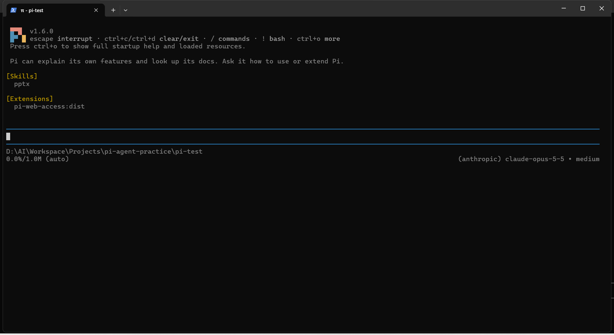

首次启动时 Pi 自动下载 fd、ripgrep 两个本地检索工具（补充截图）：

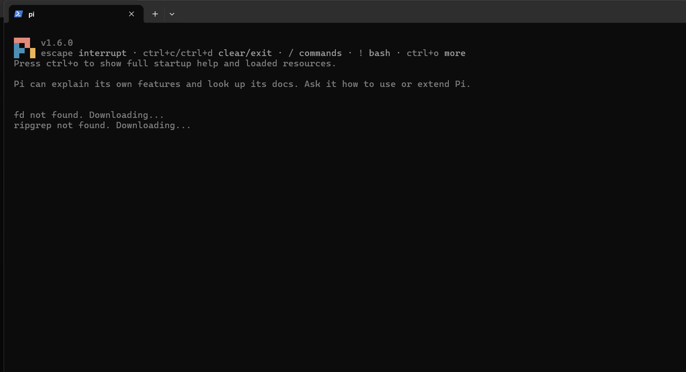

## 任务二：配置模型并完成首次会话

配置方式：DeepSeek 提供商的 API Key，通过 Pi 的 `/login` 写入本地凭据文件。密钥不进入报告、不进入截图。

切换到 `deepseek-flash` 后发送一句问候，模型正常回复。截图中同时可见：我发出的提示词、模型的实际回复、`Model: deepseek-flash` 一行，以及状态栏 `(deepseek) deepseek-flash • high`。

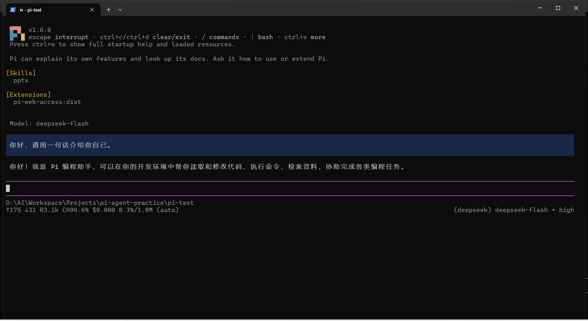

## 任务三：切换模型与思考级别

在同一个会话里先用 `/model` 选择器把模型从 `deepseek-flash` 切到 `deepseek-v4-pro`，再发送短问题「请用一句话解释持续集成」确认会话可用；随后用 `/thinking` 把思考级别从 high 调到 max。

- 图 S3a：模型已切换为 `deepseek-v4-pro`，思考级别选择器停在 high（√ high），状态栏 `(deepseek) deepseek-v4-pro • high`
- 图 S3b：思考级别切到 max（√ max），状态栏 `(deepseek) deepseek-v4-pro • max`

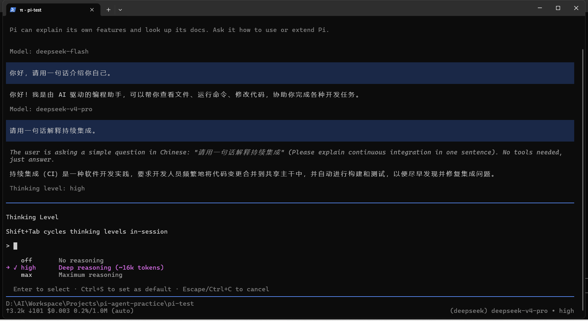

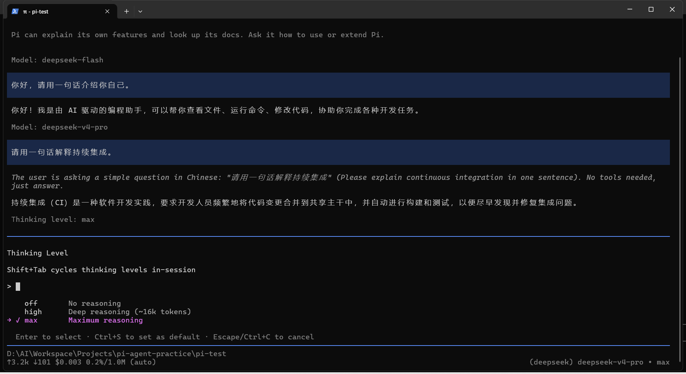

选择说明（任务复杂度如何影响选择）：

- **模型**：日常问答、读写文件、简单脚本用 `deepseek-flash`——响应快、成本低，还支持图片输入；纯文本的复杂推理切 `deepseek-v4-pro`，推理能力更强。
- **思考级别**：简单的一问一答 high 足够；多步推理、代码理解类任务用 max。高思考级别不保证答案更好，会明显增加等待时间和 token 用量，所以按任务复杂度选，不一味拉满。

## 任务四：引用代码文件与粘贴图片

### A：@ 引用 hello.py

`hello.py` 内容为加法函数 `add(a, b)` 与 `print(add(2, 3))`。输入 `@` 后从候选列表选中 hello.py（输入框显示 `@hello.py`），发送：

> 请解释 @hello.py 的功能，说明运行后输出什么。只解释，不修改文件。

模型调用 read 工具读取文件后解释了函数功能，并给出运行输出 5，未修改文件。

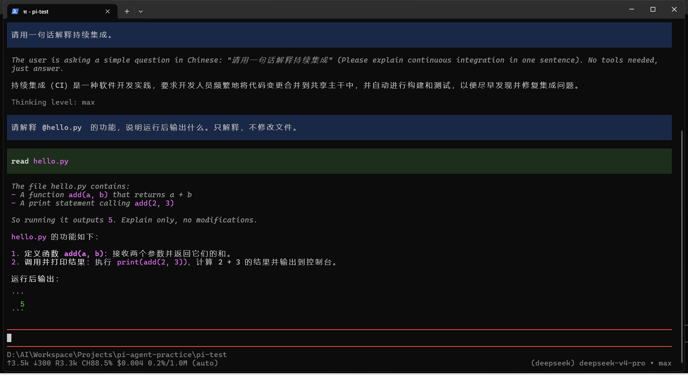

### B：粘贴小图片

自制测试图（见下图原图）：白色背景、蓝色正方形、白色数字 7。用 Alt+V 从剪贴板粘贴位图（Pi 将剪贴板图像存为临时 png 并作为附件插入输入框），发送：

> 请描述图片中的颜色、形状和数字。

模型回复：主体为蓝色（约 #0066CC）正方形，内部有白色数字 7，外围是白色背景。

原始小图片：

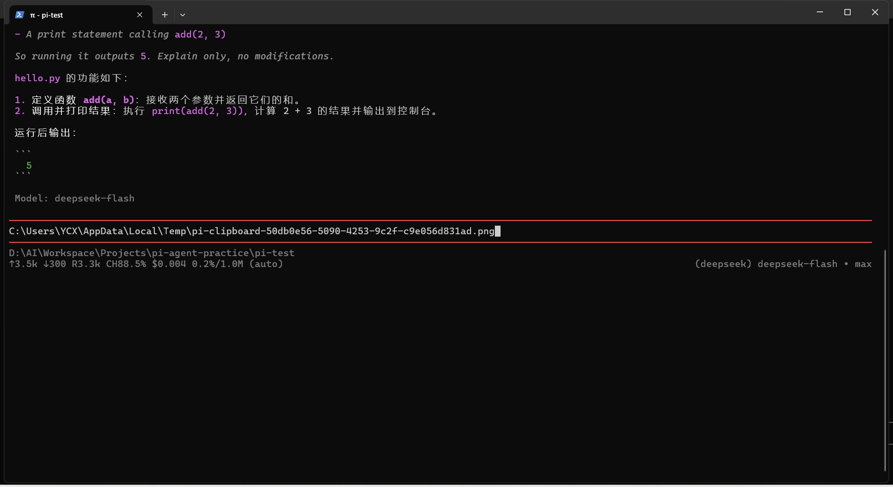

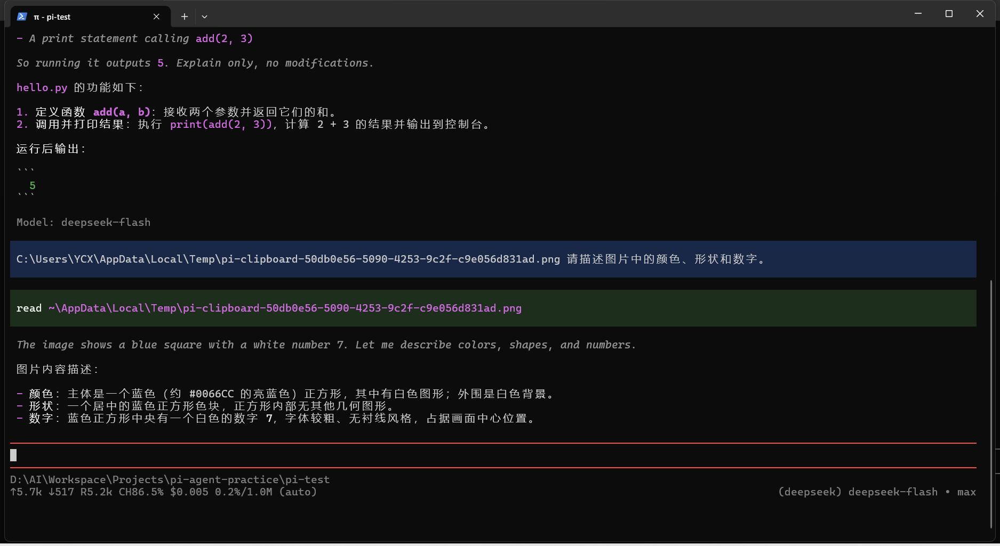

## 任务五：安装并使用插件 pi-web-access

- **所选插件**：`pi-web-access`（来源：https://pi.dev/packages 中的 npm 包 `npm:pi-web-access`）
- **安装命令**：`pi install npm:pi-web-access`（个人级安装）
- **作用**：给 Pi 增加网页抓取能力（fetch 工具）
- **所需配置**：无需额外配置，安装后重启 Pi 即加载

安装输出：`added 211 packages in 1m`、`Installed npm:pi-web-access`。重新启动 pi 后，启动区显示 `[Extensions] pi-web-access:dist`。

试用按任务书建议的最小功能「请获取 https://example.com 的页面标题」：模型调用 `fetch https://example.com`（mode: raw，577 字符），回答页面标题是 Example Domain。

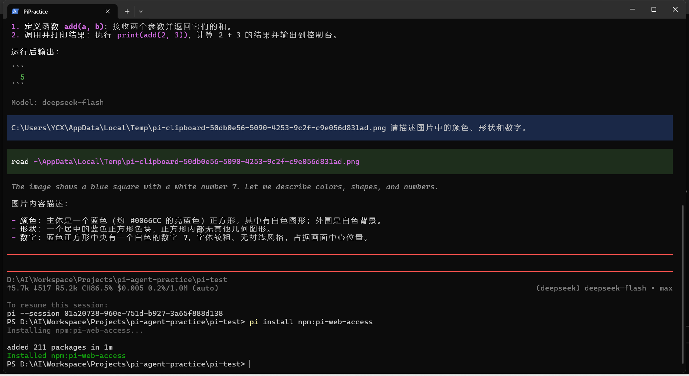

![S6b 重启后 [Extensions] 已加载](screenshots/S6b_extensions_loaded.png)

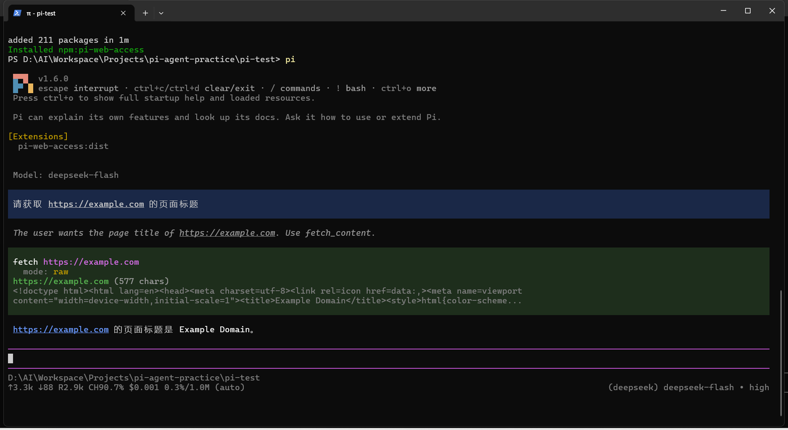

## 任务六（选做）：安装 pptx Skill

- **来源**：https://github.com/anthropics/skills 的 `skills/pptx`，commit `e4bb5d960d87126ff3b3a8af1a104b7db67560ba`
- **安装位置**：`D:\AI\Workspace\Projects\pi-agent-practice\pi-test\.pi\skills\pptx`（项目级）
- **安装方式**：由 AI 拉取官方仓库后原样复制，文件未修改；目录内 `UPSTREAM.md` 记录了来源仓库、commit 与安装日期

目录结构（含 SKILL.md、LICENSE.txt、UPSTREAM.md、scripts/ 及其子目录）：

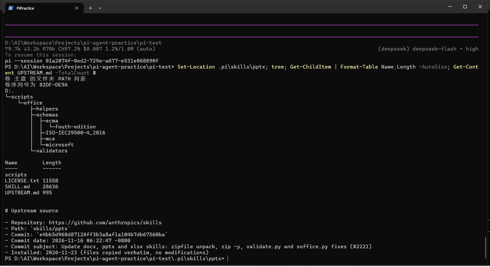

重新启动后，启动区显示 `[Skills] pptx`，说明技能被发现：

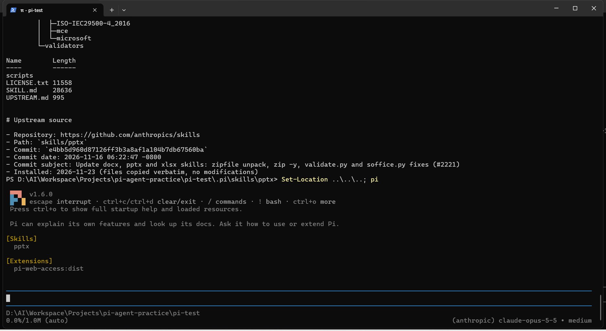

显式调用并回复（`/skill:pptx 请说明这个 Skill 的名称、用途和所在目录。`）：

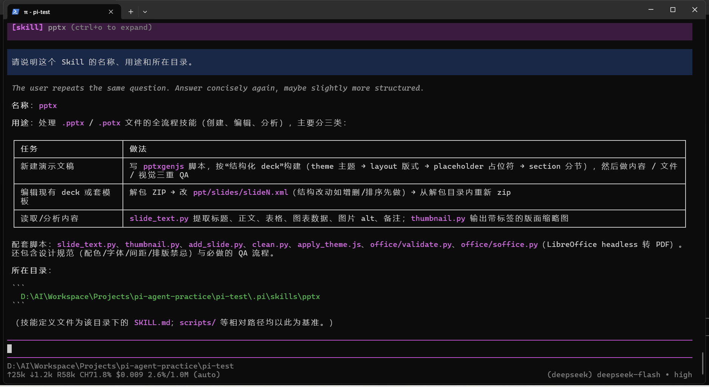

回复给出三要素：名称 `pptx`；用途是处理 .pptx/.potx 文件的全流程技能（新建、编辑、读取分析）；所在目录即本次安装位置 `D:\AI\Workspace\Projects\pi-agent-practice\pi-test\.pi\skills\pptx`。

本任务完成安装、发现、调用三个层次；任务书列为选做的「生成一个两页 PPT」未做。

## 遇到的问题与处理

1. `@` 引用必须真实按键输入 `@`——把整段提示词一次性粘贴不会弹出文件候选列表。
2. 图片粘贴走剪贴板位图（Alt+V），只复制文件路径不生效。
3. Pi 默认 fullscreen 模式下终端输入异常，按官方配置项改为 `tuiMode: "regular"` 后正常。
4. 新会话默认模型是 anthropic 的 claude-opus-5-5（本机未配置 anthropic 凭据），每次重新启动 pi 后用 `/model` 切回 `deepseek-flash`。

## 结论

六项任务全部完成：安装启动、模型配置与会话、模型与思考级别切换、@ 引用与图片输入、插件安装加载与功能调用均按任务书要求取证；选做的 pptx Skill 完成安装、发现、调用三层验证。
