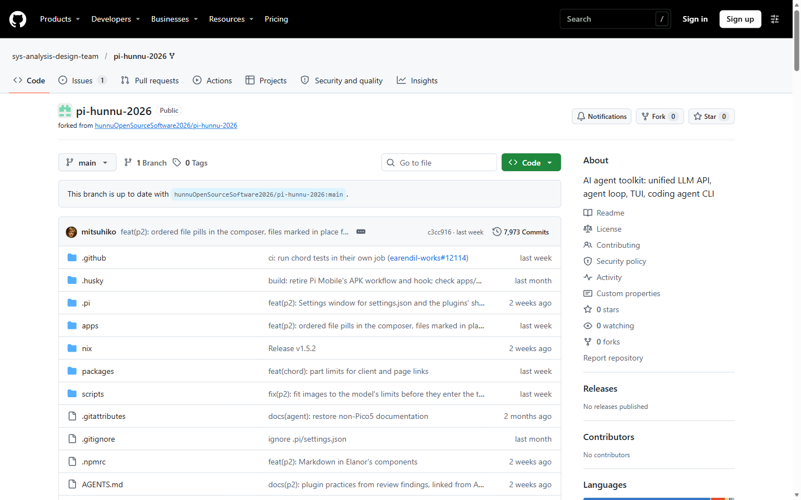
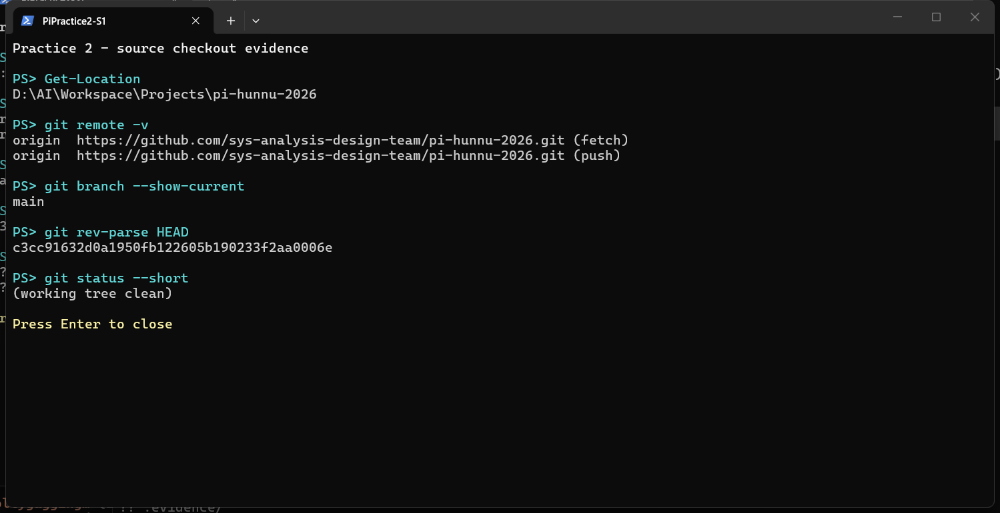
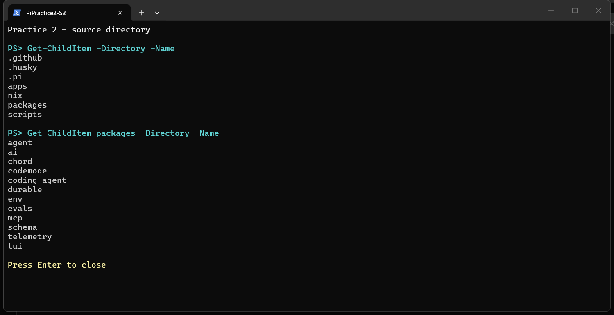
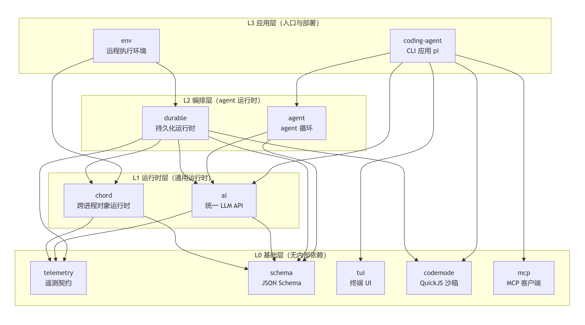
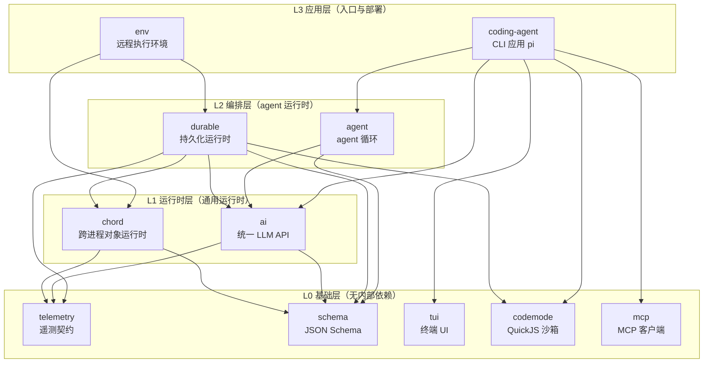

# 实践课2：组织建仓与 Pi Agent 源码分析

| 项目 | 内容 |
| --- | --- |
| 姓名 / 拼音 | 袁晨昕 / Chenxin Yuan |
| 学号 | 202430224029 |
| 专业 / 年级 | 软件工程 2024 级 |
| 小组组织 | [sys-analysis-design-team](https://github.com/sys-analysis-design-team) |
| 小组代码仓库 | https://github.com/sys-analysis-design-team/pi-hunnu-2026 |
| 个人作业仓库 | https://github.com/NXZZYUAN/open-source-practice |
| 分析对象 | 小组仓库 `main` 分支，commit `c3cc91632d0a1950fb122605b190233f2aa0006e` |
| 完成日期 | 2026-11-23 |

## 一、源码获取

### 1. 组织仓库

小组仓库已经由组长 fork 到小组 Organization 下，仓库属于 `sys-analysis-design-team`，不是个人账号，也不是教师组织。仓库页面显示它 fork 自 `hunnuOpenSourceSoftware2026/pi-hunnu-2026`，默认分支为 `main`。



### 2. 下载源码

实际 clone 地址（Issue 中以文本形式给出同一地址）：

```text
https://github.com/sys-analysis-design-team/pi-hunnu-2026.git
```

使用的命令：

```powershell
git clone --depth 1 --single-branch --branch main https://github.com/sys-analysis-design-team/pi-hunnu-2026.git
cd pi-hunnu-2026
```

说明：本机到 github.com 的连接在下载大仓库时多次中断，完整历史 clone 无法在合理时间内完成，因此加了 `--depth 1 --single-branch`。这只影响本地历史深度，不影响源码内容；本地 `HEAD` 与远端 `main` 的提交编号完全一致（`c3cc91632d0a1950fb122605b190233f2aa0006e`，已用 GitHub API 核对）。

### 3. 仓库信息与源码目录

当前目录、远端地址、分支、完整提交编号和工作区状态：



源码顶层目录与 `packages/` 下的全部子包：



## 二、任务三：子模块功能与依赖关系

### 1. 构建顺序

根目录 `package.json` 第 15 行的 `build` 脚本没有使用 npm workspaces 的自动拓扑，而是把 11 个包用 `cd` 串成一条固定链：

```text
telemetry → schema → chord → tui → codemode → mcp → ai → durable → env → agent → coding-agent
```

这条链是一个合法的拓扑序：所有被依赖的包都排在依赖它的包之前。但“相邻”不等于“互相依赖”，见后面第 4 节的逐对核对。

### 2. 模块分析表

| 子文件夹 | 代码主要实现什么功能 | 本模块 build 执行什么、生成什么 | 直接依赖哪些内部模块 | 依据文件或代码位置 |
| --- | --- | --- | --- | --- |
| `telemetry` | 与厂商无关的遥测契约：`TelemetryContext` / `TelemetrySpan`、no-op 实现、内存与指标工具、测试与渲染辅助 | `tsc -p tsconfig.build.json`，把 `src/**/*.ts` 编译到 `dist/`（JS、`.d.ts`、source map） | 无 | `packages/telemetry/README.md`；`src/index.ts`、`src/noop.ts`、`src/metrics.ts` |
| `schema` | 不依赖 `eval` 的 JSON Schema 构建与校验：schema 一次性编译为普通闭包，支持 draft 2020-12 / 7、格式校验与类型转换 | `tsc` 编译到 `dist/` | 无 | `packages/schema/README.md`；`src/compiler.ts`、`src/validator.ts`、`src/builders.ts` |
| `chord` | 跨进程对象运行时：对象契约、文档、store、链接、插件（可热重载）、SQLite、同步与多种 surface | `tsc` 编译到 `dist/` | `pi-schema`、`pi-telemetry` | `packages/chord/README.md`；`src/contracts/`、`src/documents/`、`src/node/plugins/` |
| `tui` | 终端 UI 框架：差分渲染、主屏/备屏、组件体系、编辑器、键位与布局 | `tsc` 编译到 `dist/`；原生加速模块由独立的 `build:native:*` 脚本构建，不在根 build 链里 | 无 | `packages/tui/README.md`；`src/index.ts`、`src/components/`、`src/editor-component.ts` |
| `codemode` | 在 QuickJS（编译为 WebAssembly）VM 中执行模型生成的 JavaScript，唯一能力是调用注入的工具；嵌套调用不进入 LLM 上下文 | `tsc` 编译到 `dist/`（含 `src/runtime/worker` 等运行时入口） | 无 | `packages/codemode/README.md`；`src/runtime/`、`src/wasm.ts`、`src/portable.ts` |
| `mcp` | 独立的 Model Context Protocol 客户端：传输无关的客户端核心、stdio 与 Streamable HTTP 传输、OAuth、配置 | `tsc` 编译到 `dist/` | 无（README 明确不依赖官方 MCP SDK 和其他 pi 包） | `packages/mcp/README.md`；`src/client.ts`、`src/transports/`、`src/protocol/` |
| `ai` | 统一 LLM API：provider 集合、内置模型目录、鉴权解析、token 与成本统计、图像模型、跨模型会话交接 | `generate-models` 先抓取并校验上游模型目录，生成 `src/providers/data/*.json`、`src/providers/*.models.ts`、`src/models.generated.ts`；再 `check:model-data`、`tsc`，最后把 provider JSON 复制到 `dist/providers/data/` | `pi-schema`、`pi-telemetry` | `packages/ai/README.md`、`catalog/README.md`；`src/api/`、`src/providers/`、`src/models.ts` |
| `durable` | 持久化 agent 运行时：会话、模型回合、tool call 和自定义状态先提交存储再展示；含 harness、session、storage、tasks | `tsc` 编译到 `dist/`；其 `tsconfig.build.json` 的 `paths` 直接指向 `../chord/dist/*.d.ts` 等已构建产物 | `chord`、`ai`、`codemode`、`schema`、`telemetry` | `packages/durable/README.md`；`src/harness/`、`src/session/`、`src/storage/` |
| `env` | Pi Durable 的远程执行环境：工具在另一台机器（通常经 SSH）执行，worker、存储和凭据留在本地；含 Rust daemon | `tsc` 编译到 `dist/`；Rust daemon 由独立的 `build:daemon`（cargo）构建，不在根 build 链里 | `chord`、`durable` | `packages/env/README.md`；`src/remote-env.ts`、`src/ssh.ts`、`daemon/` |
| `agent` | 通用有状态 agent：tool 执行、事件流、传输抽象，建立在 `pi-ai` 之上 | `tsc` 编译到 `dist/` | `ai`、`schema` | `packages/agent/README.md`；`src/agent-loop.ts`、`src/agent.ts`、`src/proxy.ts` |
| `coding-agent` | 面向编码的 CLI 应用 `pi`：read / bash / edit / write 工具、会话管理、TUI 交互模式、扩展与 MCP / Skill 接入 | `build:unbundled` 先 `tsc` + 给 `dist/cli.js`、`dist/rpc-entry.js` 加可执行位 + 复制主题、图片、HTML 导出模板；随后 `scripts/build-coding-agent-bundle.mjs` 用 esbuild 打包，产出 `dist/bundle/cli.js`（`bin` 的 `pi` 指向它） | `agent`、`ai`、`codemode`、`mcp`、`tui` | `packages/coding-agent/README.md`、`package.json`；`src/cli.ts`、`src/core/`、`src/modes/`；`scripts/build-coding-agent-bundle.mjs` |

### 3. 模块层级与依赖关系图

箭头方向统一为**使用方 → 被依赖方**：`A --> B` 表示 A 直接依赖 B。图中只画 `dependencies` 字段里的内部依赖，本仓库这 11 个包之间没有内部 `devDependencies` 或 `peerDependencies`，因此不需要虚线区分。



可编辑图源：[`graph/dependencies.mmd`](graph/dependencies.mmd)。同一份 Mermaid 源码如下（GitHub 会直接渲染）：



**层级划分依据：** 以“直接依赖的最长链”计算拓扑深度，而不是按目录名或构建顺序猜测。L0 的五个包没有任何内部依赖；L1 的 `chord`、`ai` 只依赖 L0；L2 的 `durable`、`agent` 依赖到 L1；L3 的 `env`、`coding-agent` 站在这条链的最上层。同层模块之间没有依赖边，例如 `chord` 与 `ai`、`durable` 与 `agent` 都互不引用。

### 4. 三个问题

**（1）根目录与子模块中的 `npm run build` 分别读取什么配置、执行什么工作？**

根目录的 `build` 只读取根 `package.json`：它不编译任何代码，也不按 workspaces 自动排序，而是按固定顺序依次 `cd` 进 11 个包，调用各自的 `npm run build`。真正的编译配置在子包里：每个包的 `build` 都是 `tsc -p tsconfig.build.json`，该文件继承根目录的 `tsconfig.base.json`（`target ES2024`、`module Node16`、`strict`、`declaration`、`declarationMap`、`sourceMap` 等），把本包 `src/**/*.ts` 编译到自己的 `dist/`，产出 JS、类型声明和 source map。

有两个包不是单纯的 `tsc`：

- `ai` 先运行 `catalog/generate.ts --strict`，抓取并校验上游模型目录，生成 `src/providers/data/*.json` 和 `src/models.generated.ts`，再编译并复制数据文件到 `dist/providers/data/`；
- `coding-agent` 先做 unbundled 编译和资产复制，再用 `scripts/build-coding-agent-bundle.mjs`（esbuild）打成一个 `dist/bundle/cli.js`，`bin` 的 `pi` 命令就指向它。

此外，`tui` 的原生模块和 `env` 的 Rust daemon 都有独立脚本（`build:native:*`、`build:daemon`），不在根 build 链里。

**（2）构建顺序和模块依赖有什么关系？相邻构建的模块是否一定互相依赖？**

构建顺序必须满足依赖关系，因为 `durable`、`env`、`agent`、`coding-agent` 的 `tsconfig.build.json` 在 `paths` 里直接引用依赖包的 `dist/*.d.ts`，例如 `packages/durable/tsconfig.build.json` 把 `@earendil-works/chord` 映射到 `../chord/dist/index.d.ts`。如果依赖包还没构建，类型解析就会失败。所以这条链是“依赖在前、使用方在后”的拓扑序。

但相邻的两个模块不一定互相依赖。逐对核对 10 组相邻关系：

| 相邻对 | 是否存在直接依赖 |
| --- | --- |
| telemetry → schema | 否 |
| schema → chord | 是（chord 依赖 schema） |
| chord → tui | 否 |
| tui → codemode | 否 |
| codemode → mcp | 否 |
| mcp → ai | 否 |
| ai → durable | 是（durable 依赖 ai） |
| durable → env | 是（env 依赖 durable） |
| env → agent | 否 |
| agent → coding-agent | 是（coding-agent 依赖 agent） |

10 组里只有 4 组是真实依赖。反过来，存在依赖但不相邻的例子很多：`schema → ai`、`telemetry → ai`、`codemode → durable`、`tui → coding-agent`。L0 内部的 `telemetry`、`schema`、`tui`、`codemode`、`mcp` 之间没有顺序约束，理论上可以互换；真正被约束的是 18 条依赖边。结论：构建顺序是依赖关系的**充分体现**（拓扑序），但相邻不是依赖的**证据**。

**（3）选择一条涉及至少三个模块的依赖路径，说明这些模块如何分工。**

取路径：**coding-agent → agent → ai → schema**（`ai` 同时依赖 `telemetry`，是这条链上的旁支）。

- `coding-agent` 是应用层：负责命令行入口、工具集合、交互模式、扩展加载和最终 esbuild 打包，把用户输入变成一次 agent 会话。
- `agent` 是编排层：实现 agent loop，维护消息与工具调用状态，把模型请求交给 `ai`，把工具执行结果回填到下一次模型调用。
- `ai` 是运行时层：屏蔽不同 provider 的差异，负责模型解析、鉴权、流式响应、token 与成本统计；它用 `schema` 校验 provider 与工具参数的结构。
- `schema` 是基础层：把 JSON Schema 编译成闭包，在运行期做无 `eval` 的校验，供上层复用。

这条链的分工原则是“每层只向下依赖一层接口”：`coding-agent` 不知道具体 provider，`agent` 不知道 TUI 和 CLI 参数，`ai` 不知道会话如何持久化。正因如此，`durable` 也能复用 `ai` 和 `codemode`，`env` 能在 `durable` 之上做远程执行，而不需要改下层代码。

### 5. 本人重点分析的模块

本人重点分析 `ai` 与 `agent` 两个模块：核对了 `ai` 的模型目录生成、provider 数据复制与 `dist` 产物，以及 `agent` 的 `agent-loop.ts` 对 `pi-ai` 的调用关系；其余模块以 `package.json`、`README.md` 和 `tsconfig.build.json` 的依赖声明为准做交叉核对。

### 6. 与任务书清单的差异

任务书列出的 11 个子文件夹在本版本中全部存在，名称一致。实际 `packages/` 下还多一个 `evals`（评测工具包），它不在这 11 个模块里，也不在根目录 `build` 链中；此外还有 `apps/p2`、`apps/p2-mac`、`apps/p3` 三个应用目录。本报告只分析任务书要求的 11 个构建模块。

## 三、问题记录

1. **完整 clone 多次中断。** 本机到 github.com 的大仓库连接不稳定，完整历史 clone 在 300 秒内未完成。改用 `--depth 1 --single-branch` 后成功；随后用 GitHub API 核对本地 `HEAD` 与远端 `main` 一致，确认源码版本没有偏差。
2. **构建顺序不能靠目录名或字母序推断。** 最初按字母序看 `packages/` 会得到完全不同的顺序；实际顺序写在根 `package.json` 的 `build` 脚本里，并以各包 `tsconfig.build.json` 的 `paths` 指向 `dist/*.d.ts` 作为依赖先后的硬证据。
3. **`git status` 里出现临时取证目录。** 截图时工作区里放了临时脚本和浏览器 profile，`git status --short` 会显示 `??`。把临时目录移出仓库后重拍，保证截图里的工作区是干净的。

## 四、结论

- 小组仓库归属正确：`sys-analysis-design-team/pi-hunnu-2026`，是教师仓库的 fork，默认分支 `main`。
- 本地源码来自该小组仓库，`HEAD = c3cc91632d0a1950fb122605b190233f2aa0006e`，与远端一致。
- 11 个模块的构建方式、产物和内部依赖已逐项落到 `package.json`、`tsconfig.build.json`、`README.md` 和源码位置。
- 依赖图共 18 条直接依赖边，按拓扑深度分为 L0–L3 四层；构建顺序是拓扑序，但相邻构建的模块不一定是依赖关系（10 组相邻对中只有 4 组）。
