# 实践课3：Pi Agent 源码安装与编译

| 项目 | 内容 |
| --- | --- |
| 姓名 / 拼音 | 袁晨昕 / Chenxin Yuan |
| 学号 | 202430224029 |
| 专业 / 年级 | 软件工程 2024 级 |
| 小组组织 | [sys-analysis-design-team](https://github.com/sys-analysis-design-team) |
| 小组代码仓库 | https://github.com/sys-analysis-design-team/pi-hunnu-2026 |
| 个人作业仓库 | https://github.com/NXZZYUAN/open-source-practice |
| 分析对象 | 小组仓库 `main` 分支，commit `c3cc91632d0a1950fb122605b190233f2aa0006e` |
| 完成日期 | 2026-11-23 |

本次任务按任务书的六个部分完成：检查环境、确认源码、阅读配置、安装依赖、本地编译、运行本地源码。第二次实践已经完成源码下载，本次在其基础上重新核对版本信息后继续。

## 一、实验准备：开发工具版本（S1）

在仓库根目录执行三条版本命令，并额外运行一次 Node.js 输出：

```powershell
node --version
npm --version
git --version
node -e "console.log('Hello, Node.js!')"
```

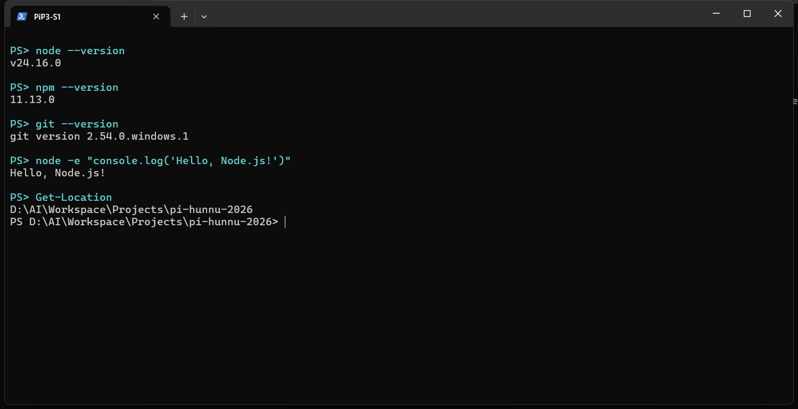

| 工具 | 实际版本 | 本次用途 |
| --- | --- | --- |
| Node.js | v24.16.0 | 运行 TypeScript 源码、构建脚本和打包工具 |
| npm | 11.13.0 | 安装依赖、执行根与子包的构建脚本 |
| Git for Windows | 2.54.0.windows.1 | 管理源码，并提供 Git Bash |

根 `package.json` 的 `engines.node` 要求 `>=22.19.0`，本机 Node.js v24.16.0 满足要求，安装过程中没有出现 `EBADENGINE`。任务书建议使用 Node.js 24 LTS，本次实际使用的就是 24 系列。

## 二、源码位置与版本（S2）

源码使用第二次实践从小组仓库 clone 的目录，本次重新核对：

```powershell
Get-Location
git remote -v
git branch --show-current
git rev-parse HEAD
git status --short
```

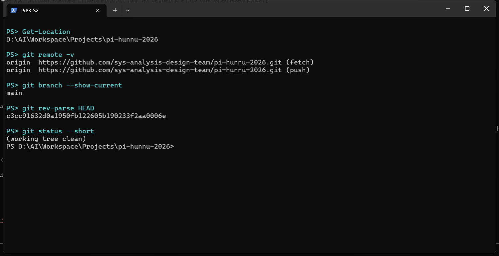

| 检查项 | 结果 |
| --- | --- |
| 当前目录 | `D:\AI\Workspace\Projects\pi-hunnu-2026` |
| `origin` | `https://github.com/sys-analysis-design-team/pi-hunnu-2026.git` |
| 当前分支 | `main` |
| 完整提交号 | `c3cc91632d0a1950fb122605b190233f2aa0006e` |
| 工作区 | 干净，`git status --short` 无输出 |

第二次实践时因本机到 github.com 的连接多次中断，使用了 `--depth 1 --single-branch` 浅克隆；这只影响本地历史深度，源码内容与远端 `main` 一致，后续安装和构建都在这个目录中进行。

## 三、安装与编译的配置依据（S3）

查看根目录 `package.json`、`package-lock.json`、`packages/` 和 `packages/coding-agent/package.json` 后，关键定义如下：

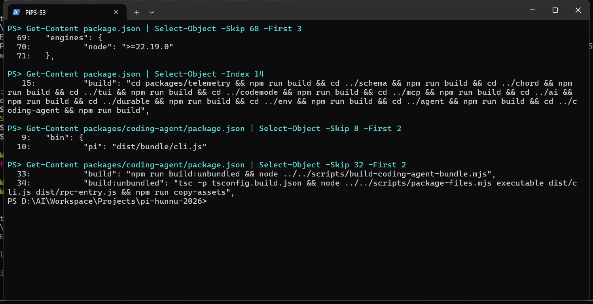

| 文件或目录 | 观察到的事实 |
| --- | --- |
| `README.md` 的 `Development` | 给出 `npm install --ignore-scripts`、`npm run build`、`npm run build:offline`、`npm run check`、`./test.sh`、`./pi-test.sh` |
| 根 `package.json` 的 `workspaces` | 包含 `packages/*`、`apps/*` 以及几个示例扩展目录，说明这是一个 npm workspaces 单仓库 |
| 根 `package.json` 的 `engines` | 第 69–70 行：`"node": ">=22.19.0"` |
| 根 `package.json` 的 `scripts.build` | 第 15 行：用 `cd packages/... && npm run build` 串起 11 个子包 |
| `package-lock.json` | 锁定依赖版本和依赖关系，安装时按锁文件解析 |
| `packages/` | 12 个子目录：11 个构建模块加 1 个 `evals` |
| `packages/coding-agent/package.json` | 第 9–10 行 `bin.pi` 指向 `dist/bundle/cli.js`；第 33–34 行为 `build` 与 `build:unbundled` |

**Node.js 版本要求在哪里？** 在根 `package.json` 的 `engines.node`，值为 `>=22.19.0`。这是项目声明的最低版本，不是每个依赖的唯一要求；实际安装时仍要结合 `npm install` 的输出判断是否有依赖提出更高版本。

**`npm run build` 实际从哪里读取命令？** npm 在当前目录读取根 `package.json`，执行其中 `scripts.build` 的字符串。该字符串不编译代码，只负责按固定顺序 `cd` 进 11 个子包并调用各自的 `npm run build`；每个子包再读取自己的 `package.json` 和 `tsconfig.build.json`。`&&` 表示前一步成功才继续，因此依赖包会先构建。

## 四、安装项目依赖（S4）

在仓库根目录执行：

```powershell
npm install --ignore-scripts
```

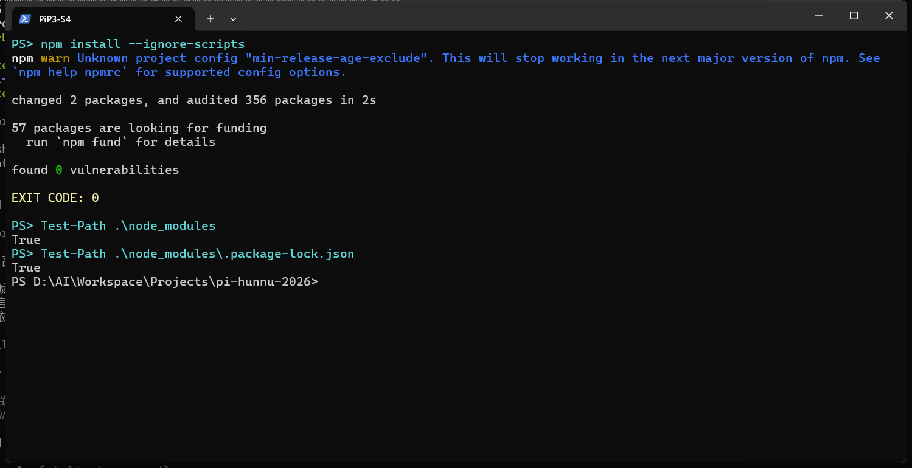

这条命令做了四件事：

- 按根 `package.json` 和 `package-lock.json` 解析、下载依赖，锁文件与声明一致时使用锁定版本；
- 在仓库根目录建立 `node_modules`，并把 `packages/*`、`apps/*` 中的工作区包链接进来；
- 安装编译器、打包器等开发依赖，例如 TypeScript、esbuild；
- `--ignore-scripts` 跳过安装阶段的生命周期脚本（如 `postinstall`、`prepare`），但不会影响后续手动执行 `npm run build`。

本次结果：

| 项目 | 结果 |
| --- | --- |
| 首次安装 | `added 333 packages, and audited 356 packages in 4m` |
| 复跑检查 | `changed 2 packages, and audited 356 packages in 2s` |
| 依赖树审计 | `found 0 vulnerabilities` |
| 退出码 | `0` |
| 目录检查 | `node_modules` 与 `node_modules\.package-lock.json` 均为 `True` |

输出中的 `npm warn` 是警告，不是失败：`Unknown project config "min-release-age-exclude"` 来自本机 npm 配置项，`deprecated node-domexception`、`deprecated prebuild-install` 是依赖维护状态提示。这些行没有让命令以非零退出码结束，也没有阻止 `node_modules` 生成。真正的错误会以 `npm error` 出现并返回非零退出码。`found 0 vulnerabilities` 只表示本次审计没有报告已知漏洞，不等于构建成功。

## 五、本地编译与构建产物（S5）

在仓库根目录执行：

```powershell
npm run build
```

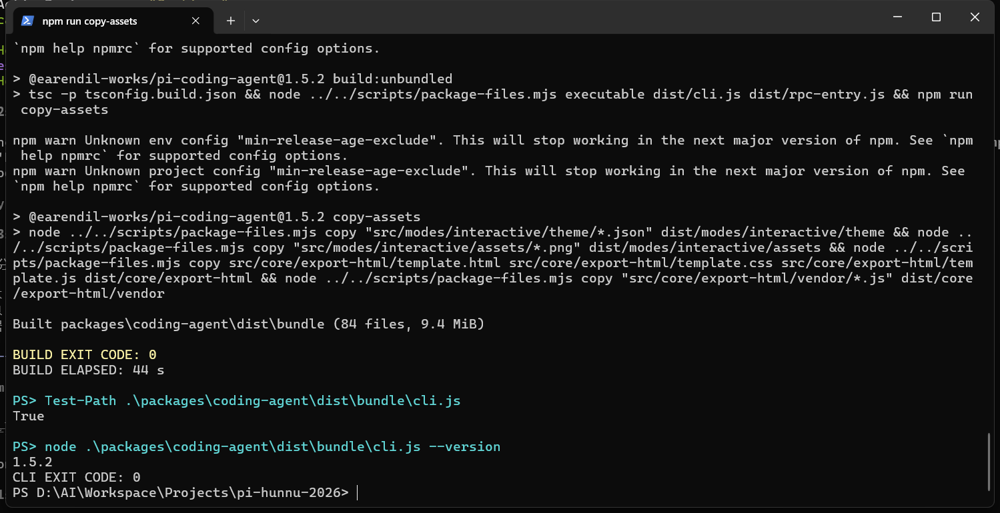

构建过程与结果：

- 根脚本依次进入 `telemetry → schema → chord → tui → codemode → mcp → ai → durable → env → agent → coding-agent`，每个子包执行自己的 `build`；
- `ai` 包先运行 `generate-models`，联网抓取 models.dev 目录、决策模型、NVIDIA NIM、OpenRouter、Vercel AI Gateway、Radius 等数据，生成 `src/providers/data/*.json` 和 `src/models.generated.ts`，再执行 `check:model-data` 与 `tsc`；
- `coding-agent` 先 `build:unbundled`（`tsc` + 复制主题、图片、HTML 模板等资产），再用 esbuild 打包 `dist/bundle`；
- 本次构建耗时 **444 秒**，日志最后一行是 `Built packages\coding-agent\dist\bundle (84 files, 9.4 MiB)`。

| 验证项 | 命令 | 结果 |
| --- | --- | --- |
| 构建退出码 | `npm run build` | `0` |
| 入口文件存在 | `Test-Path .\packages\coding-agent\dist\bundle\cli.js` | `True` |
| 编译产物版本 | `node .\packages\coding-agent\dist\bundle\cli.js --version` | `1.5.2` |
| CLI 退出码 | 同上 | `0` |
| 模型目录数据 | `packages/ai/src/providers/data` | 43 个 JSON 文件，约 1.2 MB |

`dist/bundle/cli.js` 只有 160 字节，初看容易误以为打包失败。实际它是一个启动壳：

```javascript
#!/usr/bin/env node
import { createRequire, enableCompileCache } from "node:module";

enableCompileCache();
createRequire(import.meta.url)("./cli-runtime.js");
```

真正的运行时代码在同目录的 `cli-runtime.js` 和 `chunks/` 中（80 个分块文件），整个 `dist/bundle` 共 84 个文件、9.36 MB。

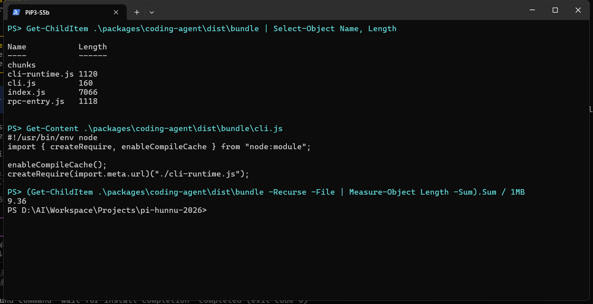

11 个包都生成了各自的 `dist` 目录。以后修改程序应修改 `src` 下的源码再重新构建；直接改 `dist` 可能在下次构建时被覆盖。模型目录数据已经生成且有效时，后续可用 `npm run build:offline` 复用数据，避免再次联网；首次安装或数据缺失时仍应使用 `npm run build`。

## 六、运行本地源码并完成一次会话（S6）

### 1. 先验证源码入口

```powershell
.\pi-test.bat --version
```

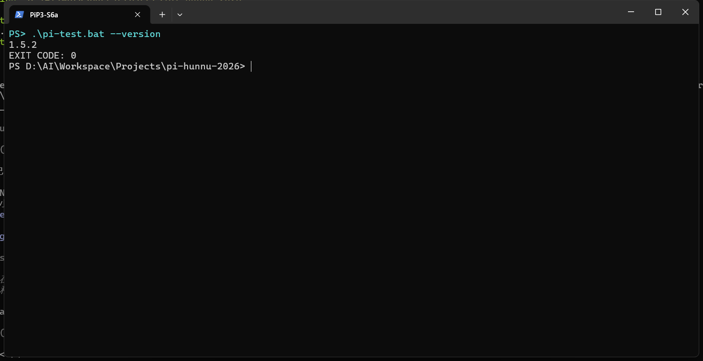

输出 `1.5.2`，退出码 `0`。这个脚本名字里有 `test`，但它是运行本地源码的入口，不是执行测试套件。`pi-test.bat` 调用 `pi-test.ps1`，后者用 Node.js 加载 `packages/coding-agent/src/cli.ts`。

### 2. 启动交互界面

```powershell
.\pi-test.bat
```

首次启动会询问是否信任当前项目文件夹：

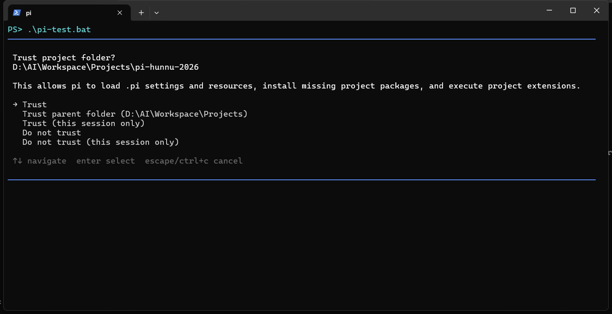

选择 `Trust` 后进入 Pi 界面，启动信息显示已加载 `AGENTS.md`、项目技能、提示词和扩展，底部显示当前目录 `D:\AI\Workspace\Projects\pi-hunnu-2026 (main)`。界面还提示有 1.6.0 新版本可用，而本地源码版本是 1.5.2，说明运行的是仓库固定提交，而不是自动更新后的全局版本。

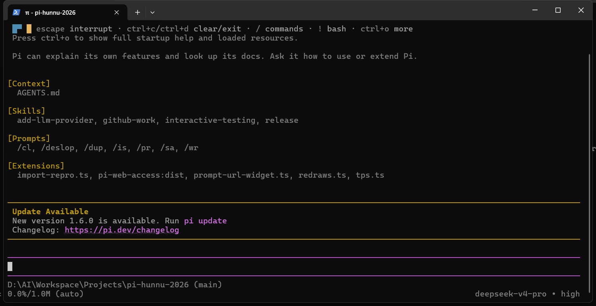

发送任务书要求的提示词：

```text
请用一句话说明源码和编译产物的区别。只回答问题，不修改文件。
```

实际收到模型回复：

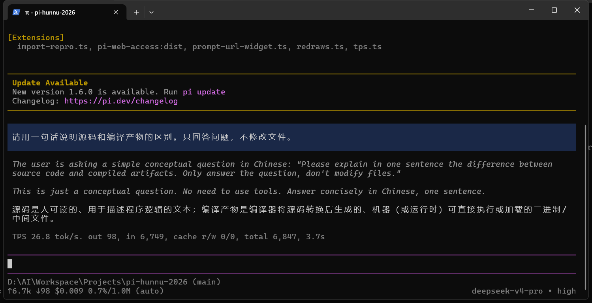

回复内容：源码是人可读的、用于描述程序逻辑的文本；编译产物是编译器将源码转换后生成的、机器（或运行时）可直接执行或加载的二进制/中间文件。

### 3. 如何确认运行的是本地源码

除了启动命令和界面中的工作目录，还可以查看正在运行的 Node.js 进程命令行：

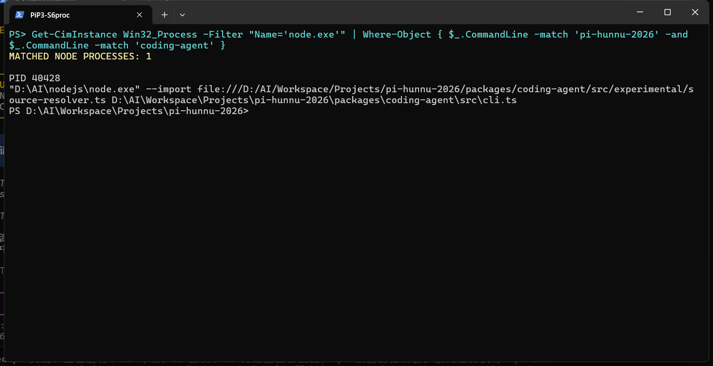

进程命令行为：

```text
"D:\AI\nodejs\node.exe" --import file:///D:/AI/Workspace/Projects/pi-hunnu-2026/packages/coding-agent/src/experimental/source-resolver.ts D:\AI\Workspace\Projects\pi-hunnu-2026\packages\coding-agent\src\cli.ts
```

其中加载的是仓库内 `packages/coding-agent/src/cli.ts`，不是 `dist/bundle/cli.js`，也不是全局安装的 `pi`，可以作为“运行本地源码”的直接证据。本地源码版默认与已安装的 Pi 共用 `~/.pi/agent` 配置目录，所以第二次实践已登录的凭据仍然有效，不需要重新 `/login`；共用配置不代表运行的是全局安装版本。

### 4. 源码入口与 `dist/bundle/cli.js` 的适用场景

| 入口 | 启动内容 | 适合场景 |
| --- | --- | --- |
| `.\pi-test.bat` | `packages/coding-agent/src/cli.ts`，通过 `source-resolver.ts` 把工作区包解析到源码 | 开发调试：改 `src` 后直接运行，不必先构建；本次实验用它证明源码可运行 |
| `node .\packages\coding-agent\dist\bundle\cli.js` | 构建后的 `dist/bundle`，入口是 160 字节启动壳，实际代码在 `cli-runtime.js` 与 `chunks/` | 交付验收、CI、没有 TypeScript 工具链的环境；启动更快，接近发布形态 |

两个入口本次都输出 `1.5.2`，说明源码与构建产物来自同一提交。

## 七、遇到的困难与解决过程（重点）

### 1. PowerShell 把 npm 的警告显示成红色错误块

第一次执行 `npm install --ignore-scripts` 时，npm 把警告写到标准错误，PowerShell 将其包装成 `NativeCommandError`，终端出现大段红色文字，看起来像安装失败。实际 npm 的退出码是 `0`，依赖已经装好，审计结果为 0 个漏洞。

解决：改用 `cmd /c "npm install --ignore-scripts 2>&1"`，让 `cmd` 先合并标准输出和标准错误，再由 PowerShell 接收；判断成败以退出码和 npm 汇总为准，不按文字颜色判断。S4 截图中保留了 `npm warn` 行和 `EXIT CODE: 0`，可以直接看出“警告不等于失败”。

### 2. 首次构建依赖网络获取模型目录

`npm run build` 不是纯离线编译：`ai` 包的 `generate-models` 要先访问 models.dev 等上游目录，生成本地模型数据后才继续 `tsc`。本次构建日志依次出现 `Fetching models.dev catalog...`、`Fetching models.dev decision models...`、`Fetching NVIDIA NIM models...`、`Fetching OpenRouter models...`、`Fetching Vercel AI Gateway models...`、`Fetching Radius models...`，随后才进入各包的编译。

如果这一步网络失败，构建会在 `ai` 包停止，后面的 `durable`、`env`、`agent`、`coding-agent` 都不会执行。解决：恢复网络后重新执行 `npm run build`；如果模型数据已经生成且仍然有效，可以改用 `npm run build:offline`。本次网络可用，构建一次通过，耗时 444 秒。

### 3. 首次运行本地源码需要信任项目文件夹

第一次执行 `.\pi-test.bat` 时并没有直接进入聊天界面，而是先出现 `Trust project folder?` 提示。若选择不信任，Pi 不会加载项目的 `.pi` 设置、扩展和技能，后续界面与功能会不完整。

解决：选择默认的 `Trust`，之后才加载 `AGENTS.md`、项目技能、提示词和扩展。这一提示是项目级安全机制，不是登录失败，也不是程序启动失败。

### 4. `dist/bundle/cli.js` 只有 160 字节

构建结束后检查产物时，入口文件只有 160 字节，最初怀疑打包没有真正完成。查看目录后发现同目录还有 `cli-runtime.js`、`index.js`、`rpc-entry.js` 和 `chunks/`，入口只是负责启用编译缓存并转发到 `cli-runtime.js`；整个 bundle 共 84 个文件、9.36 MB，构建日志也明确写出 `84 files, 9.4 MiB`。

解决：不只看入口文件大小，检查整个目录与入口内容，并用 `node cli.js --version` 实际运行验证。这属于 esbuild 分包打包的正常形态。

### 5. 完整 clone 的网络问题

第二次实践已经遇到 github.com 大仓库连接中断，本次继续使用当时的浅克隆目录，并用 `git rev-parse HEAD` 与 GitHub API 核对提交号，避免重复下载。该问题不影响本次安装和构建。

## 八、结论

- 环境满足要求：Node.js v24.16.0、npm 11.13.0、Git 2.54.0，根项目要求 `>=22.19.0`。
- 源码来自小组仓库 `sys-analysis-design-team/pi-hunnu-2026` 的 `main` 分支，提交号 `c3cc91632d0a1950fb122605b190233f2aa0006e`。
- 依赖从仓库根目录安装，`npm install --ignore-scripts` 退出码 0，`node_modules` 已生成，审计未报告已知漏洞。
- `npm run build` 按根 `scripts.build` 的固定顺序构建 11 个包，退出码 0；入口文件存在，`--version` 输出 `1.5.2`，与源码版本一致。
- 本地源码通过 `.\pi-test.bat` 启动，进程命令行确认加载的是 `packages/coding-agent/src/cli.ts`；已实际发送提示词并收到模型回复。
- 构建产物是 `dist/bundle`（84 个文件、9.36 MB），入口 `cli.js` 为启动壳，实际代码在 `cli-runtime.js` 与 `chunks/`。
- 本次不构建独立 EXE，也不部署模型权重；构建只生成 JavaScript 产物和模型目录数据。

## 九、与任务书说明的对应

- 任务二“下载源码”在第二次实践已完成，本次按任务书保留的步骤重新核对并截图（S2），没有重复 clone。
- 本次使用 Node.js 24.16.0，符合任务书建议的 24 LTS 系列；npm 使用 Node.js 附带的 11.13.0，没有另装固定版本。
- 构建日志中的 `npm warn` 均已单独说明，未把警告当成构建失败。
